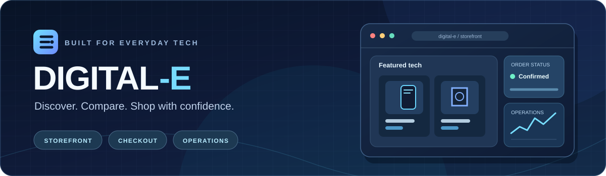
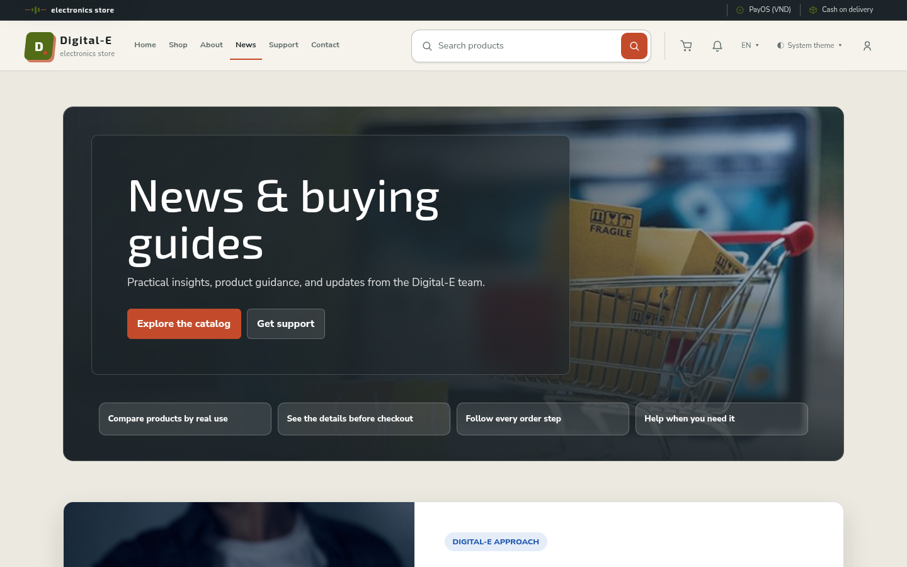
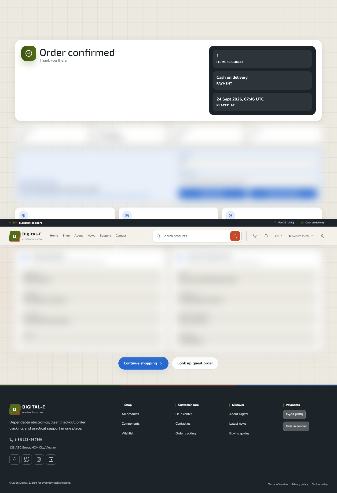
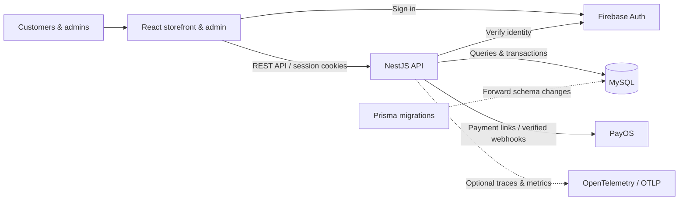
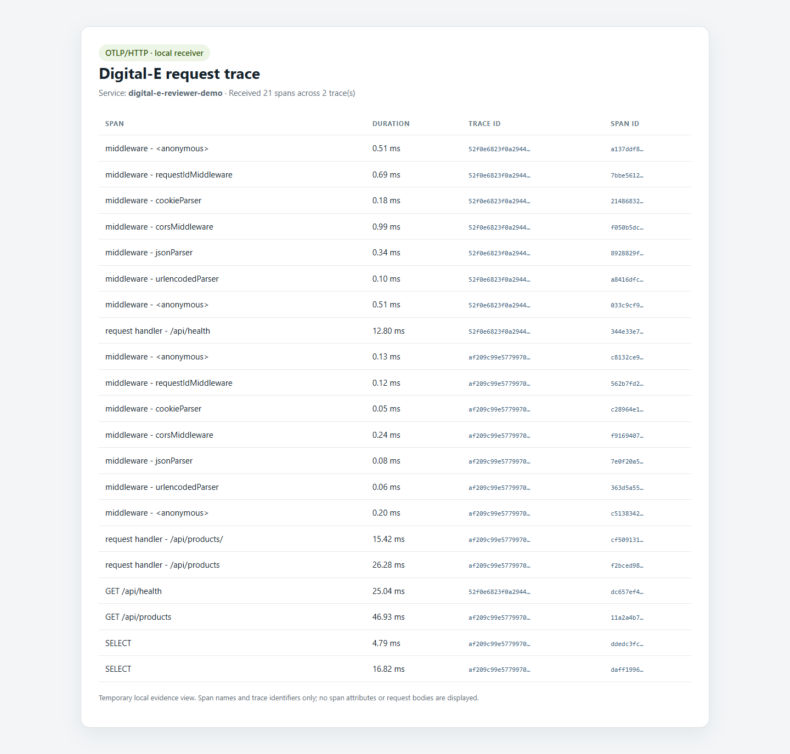

<div align="center">



# Digital-E Shop

**A modern electronics storefront backed by production-minded commerce engineering.**

Discover products, compare options, place orders, and manage the operations behind every purchase.

[**Live Storefront**](https://digital-e.vercel.app) &nbsp;·&nbsp; [**Explore the Demo**](./docs/DEMO.md) &nbsp;·&nbsp; [**Architecture**](./docs/ARCHITECTURE.md) &nbsp;·&nbsp; [**API Guide**](./docs/API.md)

**Behind the build:** [Read the Digital-E engineering case study ↗](https://www.nguyenmanhphuquy.info/case-studies/digital-e-shop/) &nbsp;·&nbsp; [Explore my software engineering portfolio ↗](https://www.nguyenmanhphuquy.info/)

[](https://github.com/memories-quy-2002/digital-e-shop/actions/workflows/ci.yml)
[](https://github.com/memories-quy-2002/digital-e-shop/actions/workflows/security.yml)


</div>

---

## At a glance

Digital-E is a full-stack electronics store with customer shopping and admin operations. The frontend and API deploy independently as separate `pnpm` packages.

| Discover & shop | Checkout & track | Operate & improve |
| :--- | :--- | :--- |
| Search, facets, product details, comparisons, reviews, and recommendations | Guest and authenticated carts, stock-aware checkout, PayOS and cash on delivery, order tracking | Product and inventory management, supplier purchasing, partial receiving, stock counts, promotions, order operations, support, notifications, and analytics |

> **For reviewers:** The [guided local demo](./docs/DEMO.md) follows one synthetic guest order from the catalog to COD confirmation and secure order lookup. It also points to the project's test and observability evidence.

## The experience

### Live website: technology guides

<div align="center">
  <a href="https://digital-e.vercel.app/news">
    
  </a>
  <sub>News and buying guides, captured from the live website on October 16, 2026.</sub>
</div>

### Guest checkout demo

<div align="center">
  <a href="./docs/DEMO.md">
    
  </a>
  <sub>Guest COD confirmation in a disposable local environment; private order and customer details are obscured.</sub>
</div>

> **Production capture status:** During screenshot collection the production catalog displayed “Unable to load products.” Catalog and admin screenshots are excluded rather than presenting broken states or local-only data as production.

## Engineering highlights

- **Commerce integrity:** The API recalculates prices, stock, discounts, and totals; reserves inventory; and reconciles PayOS links/webhooks with order state.
- **Access control:** Firebase Authentication pairs with API cookie sessions, CSRF, role/ownership guards, and protected guest-order lookup.
- **Operational clarity:** NestJS controllers/services/repositories separate contracts, workflows, and MySQL persistence; Zod validates writes. CI, tests, safe k6 profiles, structured logs, and optional OpenTelemetry support verification.

## Architecture



`client/` owns the storefront/admin UI; `server/` owns the REST API. MySQL repositories handle most runtime queries; Prisma supports selected models and forward migrations.

[Read the architecture guide →](./docs/ARCHITECTURE.md)

## Technology stack

| Layer | Technologies |
| :--- | :--- |
| **Frontend** | React 19, TypeScript 6, Vite 8, React Router 7, Tailwind CSS 4, Radix UI, Sass |
| **Backend** | Node.js 24, NestJS 11, Express 5, Zod, Pino |
| **Data & identity** | MySQL, Prisma 7, Firebase Authentication; optional Redis-backed rate limiting |
| **Payments & operations** | PayOS, COD workflows, OpenTelemetry, Vercel |
| **Testing & CI/CD** | Vitest, React Testing Library, Playwright, k6, ESLint, GitHub Actions |

## Getting started

**Requirements:** Node.js `24.22.1`, pnpm `12.4.2`, and Docker for an isolated local MySQL database. The client and server are separate packages: there is no root `package.json` or root `pnpm` workspace.

**1. Create local environment files**

<details>
<summary><strong>Windows PowerShell</strong></summary>

```powershell
Copy-Item client/.env.example client/.env
Copy-Item server/.env.example server/.env
Copy-Item server/.env.docker.example server/.env.docker
```

</details>

<details>
<summary><strong>macOS / Linux / Git Bash</strong></summary>

```bash
cp client/.env.example client/.env
cp server/.env.example server/.env
cp server/.env.docker.example server/.env.docker
```

</details>

Configure Firebase and database settings using the [development guide](./docs/DEVELOPMENT.md). Never commit credentials.

**2. Install dependencies and prepare the disposable database**

```bash
pnpm --dir client install
pnpm --dir server install
pnpm --dir server docker:setup
```

**3. Start the application** (use three separate terminals)

```bash
pnpm --dir server firebase:emulator
pnpm --dir server dev
pnpm --dir client dev
```

| Service | Local URL |
| :--- | :--- |
| Storefront & admin | [http://localhost:5173](http://localhost:5173) |
| API | [http://localhost:4000](http://localhost:4000) |
| Interactive API reference | [http://localhost:4000/docs](http://localhost:4000/docs) |

**Safety:** The database setup and demo seed are intended for a disposable local environment, not production or shared data. Follow the [development guide](./docs/DEVELOPMENT.md) for environment-specific requirements.

## Testing & observability

Run the key package checks independently:

```bash
pnpm --dir client exec tsc -p tsconfig.json --noEmit
pnpm --dir client test -- --run
pnpm --dir client build

pnpm --dir server typecheck
pnpm --dir server test -- --run
pnpm --dir server build
```

For an explicitly approved, seeded local API, a **read-only k6 smoke profile** checks public API behavior with a maximum of five virtual users:

```bash
pnpm --dir server perf:setup
pnpm --dir server perf:smoke
```

OpenTelemetry is opt-in; it exports HTTP, Express, and MySQL spans plus metrics over OTLP/HTTP. Query strings and SQL literals are scrubbed; normal local development needs no collector.

<details>
<summary><strong>View local OpenTelemetry evidence</strong></summary>



See the [reviewer demo](./docs/DEMO.md) for the evidence scope and [architecture guide](./docs/ARCHITECTURE.md#observability) for telemetry configuration.

</details>

See the [testing guide](./docs/TESTING.md) and [k6 safety guidance](./server/test/README-k6.md) before running integration or load tests against any target.

## Documentation

| Guide | Contents |
| :--- | :--- |
| [Reviewer demo](./docs/DEMO.md) | End-to-end guest order walkthrough and evidence |
| [Development](./docs/DEVELOPMENT.md) | Environment, local setup, deployment variables, and workflows |
| [Architecture](./docs/ARCHITECTURE.md) | System boundaries, data model, authentication, and observability |
| [API](./docs/API.md) | Routes, response conventions, and authentication |
| [Testing](./docs/TESTING.md) | Unit, integration, browser, and performance verification |
| [CI/CD](./docs/ci-cd.md) | Automation and release controls |
| [Project Wiki](./Wiki/index.md) | Domain decisions and durable project knowledge |
| [Contributing](./CONTRIBUTING.md) · [Security](./SECURITY.md) | Contribution practices and vulnerability reporting |

---

<div align="center">
  <strong>Digital-E Shop</strong><br/>
  Built and maintained by <a href="https://github.com/memories-quy-2002">Nguyen Manh Phu Quy</a><br/>
  <a href="https://digital-e.vercel.app">Explore the storefront</a> · <a href="https://www.nguyenmanhphuquy.info/">My portfolio</a> · <a href="https://github.com/memories-quy-2002/digital-e-shop/issues">Report an issue</a>
</div>
