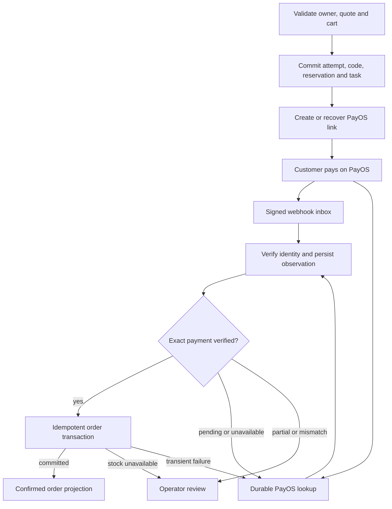

# PayOS checkout reliability design

Date: 2026-10-15. Status: proposed; written spec and companion plan await owner review before implementation.

Audience: product owner, backend/frontend implementers, QA and operators.

## Outcome and scope

Complete authenticated and guest PayOS checkout with truthful customer status, idempotent order creation and durable recovery. A successful API request, browser redirect or cached receipt is never proof of payment. Success requires a verified PayOS payment and a committed Digital-E order.

The requested deliverables for this task are this spec and the [implementation plan](../plans/2026-10-15-payos-checkout-reliability.md). Runtime changes described here are proposed, not implemented by these documents. Existing retail P0 shipping, email, COD settlement and refund behavior remains the baseline.

Scope includes payment-link creation, resumption, cancellation, expiry, webhook processing, reconciliation, inventory/promotion finalization, exceptional paid checkouts, customer UI and operator recovery. Automatic bank payouts/refunds, another payment provider, a new queue platform and deployment of an external scheduler are excluded. Recording a manual refund requires evidence of an actual transfer; an operator click does not transfer funds.

## Constraints

- Node.js 24.20.0; pnpm 12.4.2; independent client/server packages; no new dependency by default.
- Preserve existing route aliases, route-local response envelopes, authentication, verified-email creation gate, ownership, CSRF and CORS behavior.
- New money values are safe whole-number VND; preserve historical payment/currency records without conversion.
- SQL belongs in repositories; services own orchestration; controllers parse and format; frontend uses feature API wrappers and the shared HTTP client.
- Keep the existing 35-minute reservation duration. Support English/Vietnamese, light/dark, mobile/desktop and keyboard use.
- Production rejects mock PayOS. Local simulation, isolated-DB evidence and real PayOS acceptance are separate evidence categories.

## Current evidence and alternatives

Source inspection identified these gaps:

| Source | Current behavior | Consequence |
| --- | --- | --- |
| `server/src/orders/orders.payos.service.ts` | Saves provider order code/reference after external create; releases reservation on create failure | Early webhook lookup can miss checkout; ambiguous timeout can leave a payable orphan |
| `server/src/payments/payment-reconciliation.service.ts` | Exact comparisons and signed-webhook processing already exist | Reuse this boundary; do not invent a competing payment authority |
| `server/src/payments/payment-reconciliation.repository.ts` | Pending candidate query selects only `PENDING` reservations | Released/expired but paid checkouts can escape recovery |
| `server/src/orders/orders.service.ts` | Finalizer rejects expired/non-pending reservations | Received money may never become an order after a late notification |
| `client/src/features/orders/pages/CheckoutSuccessPage.tsx` | Prior cached success can suppress polling; confirmation heading precedes confirmation; polling errors are swallowed | False confirmation, stale order and misleading timeout copy |
| `client/src/features/orders/pages/checkoutSuccessStorage.ts` | Pending cache lacks attempt/order-code binding | Cache cannot safely identify the returning payment |
| `server/src/operations/task-runner.service.ts` | Durable bounded runner handles email/shipping | Extend explicit dispatch for PayOS; do not add detached timers |

Browser-only verification is insufficient when a tab closes or webhook delivery fails. Webhook-only processing misses delayed/lost delivery and link-creation ambiguity. Selected approach: signed webhook as the primary notification, server-to-server PayOS lookup as recovery, and one shared processor writing durable payment facts and finalizing orders.

## Sources of truth and states

PayOS provides payment evidence; MySQL provides expected amount, ownership and committed order state. Frontend renders the owner-scoped backend projection.

`paymentState`: `UNKNOWN | PENDING | PARTIAL | PAID | CANCELLED | EXPIRED | MISMATCH`.
`orderState`: `NOT_CREATED | FINALIZING | CREATED | REVIEW_REQUIRED`.
`resolutionState`: `NONE | OPEN | REFUND_RECORDED | RESOLVED`.

`PAID` means exact expected payment verified, not delivered goods. Under/overpayment or inconsistent identity is preserved as an observation and escalated, never discarded as no money received. Only `PAID + CREATED + orderId` renders order confirmation. A positive verified receipt cannot be erased by an older pending/cancelled/expired event. Refund state is separate; do not rewrite the historical paid fact.

| Backend projection | Customer behavior |
| --- | --- |
| Unknown/provider unavailable | Unable to verify yet; retry/resume; no claim that money was received |
| Pending | Waiting for payment; show server expiry and valid resume link |
| Partial/mismatch | Verification requires support; show a safe reference, no sensitive bank data |
| Paid + finalizing | Payment received; order is being completed |
| Paid + created | Confirm order with DB totals and order ID |
| Paid + review required | Payment received; staff are resolving the order; support reference |
| Cancelled/expired without verified funds | Payment cancelled/expired; allow fresh checkout after safe release |
| Refund recorded | Explain completed manual refund from audited server state |

## Persistence and responsibility

Add one `payment_attempts` row per PayOS checkout attempt, linked uniquely to its existing `pending_checkouts` row. Store opaque UUID `id`, owner scope (user ID or server guest-cart identity), scoped idempotency key, canonical request hash, immutable snapshot hash, unique safe-integer provider order code, nullable provider link ID/URL, expected VND, payment/order/resolution states, nullable unique order ID, expiry, create lease token/deadline, reconciliation timing and timestamps. Persist code and expected amount before calling PayOS. Enforce unique `(owner_scope, idempotency_key)`, `(provider, provider_order_code)` and `(provider, provider_link_id)` (nullable link ID).

Generate a cryptographically random positive safe-integer order code and retry DB unique collisions, at most five times; persist before external use. Do not derive uniqueness from wall-clock arithmetic. Reuse reservation UUID as the public attempt ID where possible. No network calls inside DB transactions.

Add append-only `payment_attempt_observations`: attempt ID, source (`WEBHOOK | LOOKUP`), source event/reference key, canonical payload hash, provider identity, expected/reported/paid VND, normalized provider status, verified-at time, sanitized reason. Unique source keys deduplicate identical deliveries; conflicting payloads are flagged without overwriting evidence. Store only necessary evidence, not raw credentials or bank-account details. Existing `payment_webhook_events` remains the signature-verified webhook inbox; do not duplicate its claim/fencing machinery.

Use existing reconciliation-attempt auditing for lookup outcomes. The attempt/observation commit is independent of the order transaction: a later stock or DB failure must not roll back the fact that money was received. Order ID and `CREATED` are committed atomically with the order, payment ledger, stock movement, promotion redemption, timeline and transactional-email enqueue.

Add `payment_attempt_refunds` only for exceptional paid attempts without an order: immutable operation ID, attempt ID, globally unique transfer reference/idempotency key, VND amount, transfer date, evidence ID, actor and reason. Reuse private `financial_evidence` storage/access rules. Existing after-sales/manual-refund eligibility remains unchanged for real orders. Lock attempt while validating refund total against independently verified received funds. For attempts with an order, direct operators to the existing order refund workflow; never allow both refund paths to spend the same receipt.

## Create and resume contract

Existing authenticated and guest PayOS creation routes accept an additive `Idempotency-Key` UUID header. The updated frontend always sends it; legacy callers may omit it during rollout but still receive a persisted attempt. CORS must allow this explicit header. Hash canonical validated input (owner, cart selection, address, quote ID, promotion and contact) without logging the payload. Validate positive safe-integer totals from server calculations, including shipping and discount.

1. In one transaction, claim owner/key, validate/reserve cart, save immutable snapshots and payment attempt/code, then enqueue `PAYOS_RECONCILE`. Duplicate key/same request returns the same attempt without re-reserving, re-consuming an expiring quote, or creating a second link. Same key/different request returns 409.
2. Acquire a fenced 30-second create lease; cap the external create call at 10 seconds. Disable SDK-level automatic create retries when supported; otherwise enforce timeout at the PayOS adapter boundary and ensure the application performs GET-by-code recovery before any repeat create. Competing requests receive the attempt with `sessionState=CREATING`, not a second outbound create. Worker and request creation share this lease.
3. Create or recover link by the saved code. After timeout/connection loss, lookup that code before retrying create; never immediately release stock or invent a new code. A retry uses the same code only after an authoritative not-found response and a recheck that the attempt is still payable. Unknown/network errors preserve `UNKNOWN` and schedule recovery.
4. Check returned code, link ID, amount, currency and checkout URL against configured PayOS HTTPS origins; local simulator URL is allowed only in mock mode. A first verified callback can attach the missing link ID by the already-persisted unique code, after exact amount/currency validation. A later create response must match that binding.
5. Add `attemptId`, `sessionState` (`CREATING | READY | CLOSED`) and nullable `url` to response, preserving existing URL/code/token fields when available. A 202 response can represent creation/recovery in progress. Explicit provider validation rejection closes the attempt and releases its hold; uncertain outcomes do not.

Return/cancel URLs use the existing checkout-result route and opaque attempt ID. Query parameters such as `status`, `code` or `cancel` are hints only. Never include guest access tokens in URLs, emails, logs or task payloads. Preserve old order-code return links through an owner-checked legacy lookup adapter.

## Ownership and status APIs

Proposed additive routes under `/api/orders`:

| Route | Authorization and behavior |
| --- | --- |
| `GET /payment-attempts/:attemptId` | AuthGuard; authenticated owner only; cheap DB projection |
| `POST /guest/payment-attempts/:attemptId/status` | Existing server guest-cart cookie identity; CSRF; cheap DB projection |
| `POST /payment-attempts/:attemptId/reconcile` | Authenticated owner; CSRF; coalesced enqueue, 202 |
| `POST /guest/payment-attempts/:attemptId/reconcile` | Guest cookie identity; CSRF; same enqueue |
| `POST /payment-attempts/:attemptId/cancel` and guest counterpart | Same respective ownership/CSRF; persist cancellation intent and enqueue |

Use request-local authenticated identity, never trust a user ID from body. Wrong/unknown owner receives the same 404 shape. Guest attempt ID alone grants no access. Same-browser cookie identity supports a lost response/refresh without recovering a raw token from its hash. Existing guest order token remains valid for existing order lookup; on replay do not regenerate it or invalidate an already-issued capability. Do not include that token in replay/status responses. Cross-device guest recovery remains the existing order-token flow; clearing the guest cookie requires support and does not grant public access by order code.

Status projection includes attempt ID, provider order code (string), payment/order/resolution states, nullable order ID, item/pricing/delivery display snapshots, subtotal/discount/shipping/payable VND, currency, expiry, last checked time, retry-after seconds, safe support reference and nullable validated resume URL. Never return email/address/phone to unauthenticated callers or detailed provider internals. Set `Cache-Control: no-store`.

Status GET/POST does not synchronously call PayOS. Limit status reads to 60/minute per owner+attempt; reconcile/cancel requests to 6/minute with at most one lookup scheduled per attempt per 15 seconds. Return 429 plus Retry-After, preserving existing general rate limits.

## Shared processing and recovery

Webhook uses SDK verification before trusting signed data. Preserve current narrow webhook CSRF exception. Registration probes/unknown codes acknowledge safely and are audited; known attempts must exist before provider create. Once a verified inbox event and recovery task are committed, acknowledge 200; if that durable write fails, return retryable 5xx. Delivery processing must survive a crash after inbox commit and before order creation.

Lookup compares saved order code, link ID, exact expected VND, exact `amountPaid`, currency contract and `status === PAID`. HTTP 200 or PayOS envelope `code === 00` means request success, not payment success. GET currency is normalized as VND by the existing adapter, not an independently returned field. Signed webhook success with exact verified identity/amount is sufficient payment evidence; conflicting evidence or missing binding triggers lookup/review. Reuse a single comparison/processing path for webhook, scheduled and admin recovery.

Add explicit `PAYOS_RECONCILE` dispatch to the existing MySQL task runner, preserving shipping/email dispatch. Use existing 60-second task lease and 20-second runner budget; one provider call per claimed task, at most 10 seconds, no automatic nested SDK retries. Persist the continuation before finishing the current task. A success consumes a task generation, not the lifecycle of a still-pending payment: enqueue a new generation keyed by attempt ID + generation. Lease failures retain existing bounded retry/fencing behavior; after eight failed deliveries mark review-required and expose admin retry.

Lookup schedule: initial recovery due 15 seconds after create, then 30 seconds while pending until expiry. On provider errors, exponential delay 15/30/60/120/240/300 seconds with jitter and respect provider Retry-After (minimum 15 seconds). Cancellation/expiry performs lookup first, cancels a still-open provider link, then performs a later verification lookup before releasing the hold. If cancel API reports paid, process payment. Unknown cancellation outcome cannot prove no funds. Release expired holds after a cancellation/verification timeout of 10 minutes, mark review-required, and retain recovery eligibility; this bounded business rule releases inventory without asserting that payment cannot arrive.

Reconcile expired/released/cancel-intent attempts and unresolved paid cases, not just `pending_checkouts.status=PENDING`. Continue scheduled checks for 24 hours after expiry, then surface unresolved cases in the admin queue with manual retry and an audit alert. A later verified webhook still reopens recovery. Scheduler downtime means eventual recovery waits for the existing authenticated runner invocation; deployment is a separate acceptance gate, never a hidden local interval.

## Finalization, cancellation and financial exceptions

Lock attempt, pending checkout and product rows in a consistent order. Concurrent webhook/query/admin workers must yield exactly one order, one stock decrement, one promotion consumption and one confirmation-email business key. If already created, return that order; never recreate it from the latest cart.

For an expired/released hold with verified payment, use original snapshots and promotion value. Under product locks, availability equals physical stock minus other active reservations, excluding this attempt's own active reservation. Enough stock allows a recovered order; insufficient stock opens `REVIEW_REQUIRED` and keeps the receipt. Do not steal other customers' stock or silently substitute/reprice items. A promotion reservation that expired must be converted once for the original paid snapshot; do not re-run current promotion pricing or lose paid discounts.

Cancellation intent serializes with finalization. Before an order exists, a verified payment observed after cancellation remains a paid exception for operator resolution; do not silently create a new order against the customer's cancellation intent. If order commit won the race, return the order and use its established cancellation policy. Persisted refund operation blocks future finalization of that attempt. Partial refunds leave the case open; total recorded refund closes it. Operator resolution can retry fulfillment only when no cancellation intent/refund exists and all invariants still hold.

Extend existing admin payment surface with a paginated exception queue (25/default, 100/max), sanitized detail/evidence links, audited retry and orphan-refund recording. Role guards precede business logic. Recording a refund requires positive whole VND, unique transfer reference, transfer date, reason and private uploaded evidence; concurrent requests cannot exceed received funds. No guest/customer endpoint can close a financial exception.

## Frontend behavior and accessibility

Bind pending storage to version, attempt ID and provider order code. Cache is only a navigation aid; always fetch the selected attempt and show server totals. An old success slot cannot suppress verification of a new attempt. Refresh and no-cache entry work from authorized backend snapshots. Never clear the cart just because a return URL says success. On confirmed creation, clear only items included in the immutable checkout snapshot; preserve items/quantity added while payment was open.

Poll backend status every 2 seconds for the first 30 seconds, then every 5 seconds, stopping automatic polling at 120 seconds or terminal state. Continue provider recovery independently. Offer explicit check-again/resume actions after polling stops. Pause while hidden/offline; resume on visibility/connection recovery without parallel timers. Respect Retry-After. Display authentication-required, forbidden/not-found, offline and server errors distinctly; do not catch them all as pending payment.

Use localized state-specific headings. Exact English confirmed heading: `Order confirmed`; Vietnamese: `Đơn hàng đã được xác nhận`. Paid-but-uncreated: `Payment received — we're completing your order` / `Đã nhận thanh toán — đang hoàn tất đơn hàng`. Unknown status must not claim receipt. Provide semantic heading, polite live region for state changes, keyboard-accessible retry/resume/support actions, visible focus and accessible pending/error text. Move focus to the result heading once per navigation, not on each poll; avoid repeated screen-reader announcements.

## Acceptance and completion evidence

| ID | Required proof |
| --- | --- |
| AC01 | Same key/body, concurrent create and lost response produce one attempt/link/reservation; changed body yields 409; expired quote replay still resumes original attempt |
| AC02 | Early signed webhook before create response, timeout, provider not-found and crash after provider acceptance all recover without a second payable code |
| AC03 | Bad signature/identity/currency, under/overpayment, stale events and conflicting replay never falsely confirm or erase receipt evidence |
| AC04 | Duplicate webhook + lookup + admin concurrency creates one order/ledger/stock movement/promotion/email; crash after receipt commit remains recoverable |
| AC05 | Payment after expiry succeeds if free stock exists; competing holds/stock shortage produce a paid exception; original shipping/discount snapshots survive |
| AC06 | Cancellation/expiry races and unknown provider responses preserve money facts; cancellation/refund blocks later fulfillment; late callback still opens recovery |
| AC07 | Cross-owner, guessed attempt, guest cookie loss, CSRF failure and rate limits expose no private order data; existing guest token lookup remains valid |
| AC08 | Stale cache/new attempt, refresh/no storage, altered return params, auth failure, offline and polling timeout display truthful states and DB totals; cart edits survive |
| AC09 | Durable leases, retry budget/Retry-After, task generations, scheduler restart and 24-hour escalation work without breaking email/shipping tasks |
| AC10 | Admin review/refund requires role/private evidence, is idempotent and capped under concurrent requests; no order/after-sales eligibility fabricated |
| AC11 | Browser guest and authenticated flows pass EN/VI, light/dark, desktop/mobile, keyboard and live-region checks |
| AC12 | Additive migrations, legacy paid/pending return links, rollback-compatible code rollout and actual PayOS acceptance are documented and verified at their respective gates |

Local completion requires changed unit suites, isolated MySQL concurrency/integration tests, full package typecheck/lint/build/test and browser suites. Real PayOS acceptance separately requires configured credentials, public HTTPS webhook registration, authenticated scheduler invocation and an owner-approved controlled payment. Demonstrate exact VND, PayOS PAID, local order ID and one stock movement, then missed-webhook lookup recovery. Store redacted evidence; never automate a real transfer from this plan. Until those external gates pass, describe the feature as locally verified, not live accepted.

Migration rollout: additive tables/indexes first; deploy readers capable of both attempt-backed and legacy flows before enabling new creation. Create attempts for legacy pending PayOS rows only where existing code, amount and owner binding are valid; flag unresolved guest ownership for support rather than guessing. Keep legacy paid-order lookup functional. Roll back application behavior without deleting receipt/audit rows or dropping tables. No migrations run against production as part of writing these documents.

## References and baseline

- [Official PayOS Node SDK](https://payos.vn/docs/sdks/back-end/node/): create/get/cancel and signed webhook verification.
- [Official PayOS API](https://payos.vn/docs/api/): payment-request identity, amount/status and webhook contracts.
- [Hosted checkout guide](https://payos.vn/docs/checkout/quick-start-payos-hosted-page/): return/cancel and webhook flow.
- Repository baseline from preceding audit: 55 backend tests across seven payment/reservation files and 25 client tests across four checkout/API/storage files passed. This is baseline evidence, not verification of the proposed implementation; no real PayOS transfer was performed.
